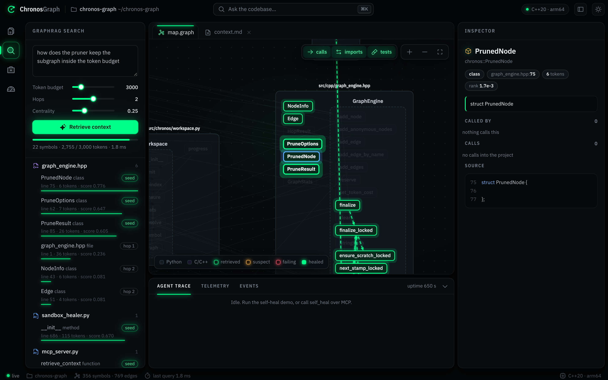
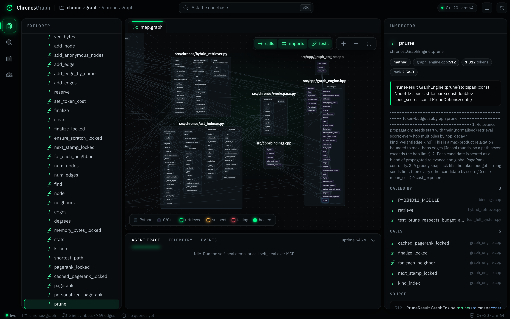
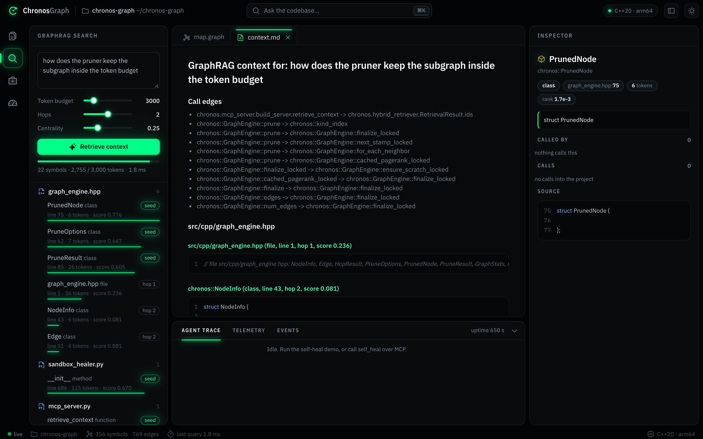
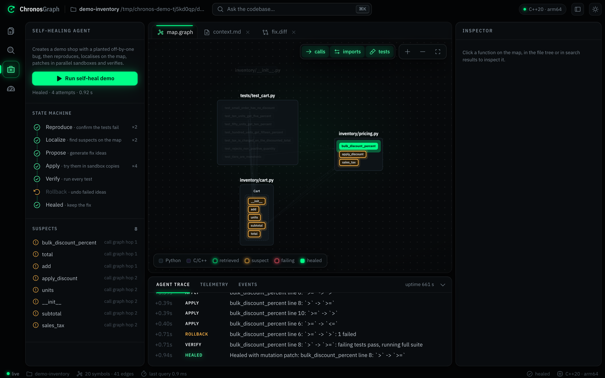
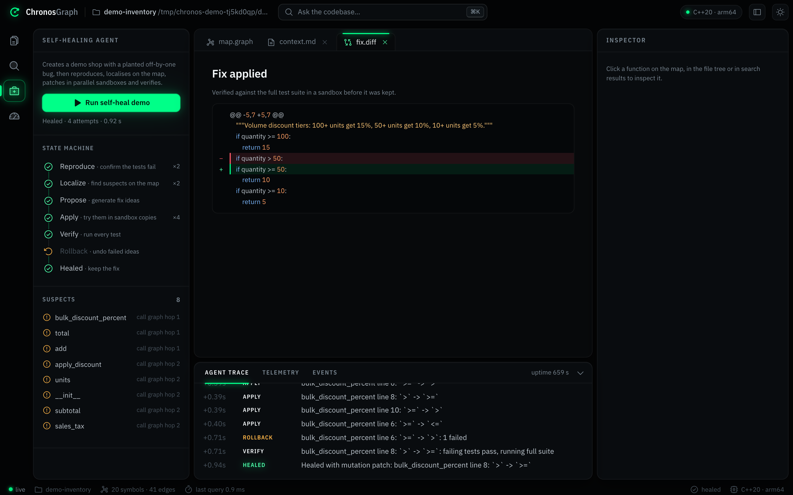
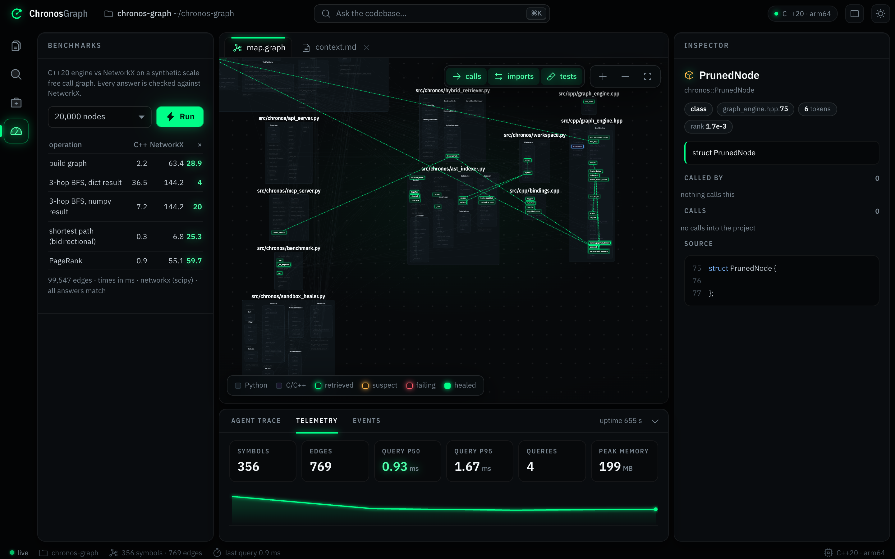
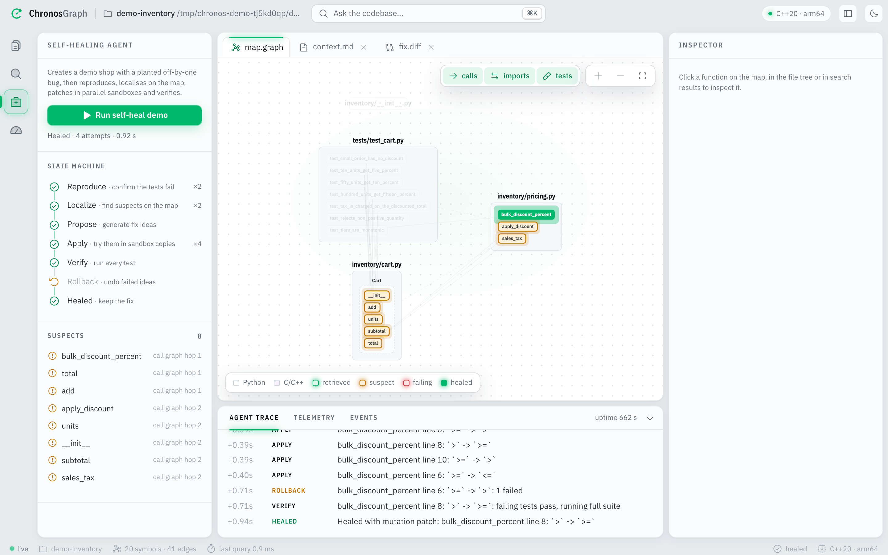

<p align="center">
  
</p>

<h1 align="center">Chronos-Graph</h1>

<p align="center">
  <b>A C++20 code-graph engine that hands AI agents exactly the code they need, and fixes failing tests on its own.</b>
</p>

<p align="center">
  
  
  
  
  
</p>

---

## Contents

- [What it does](#what-it-does)
- [Highlights](#highlights)
- [Tour](#tour)
- [Architecture](#architecture)
- [Quick start](#quick-start)
- [Connect it to an MCP client](#connect-it-to-an-mcp-client)
- [Benchmarks](#benchmarks)
- [How it works](#how-it-works)
- [Configuration](#configuration)
- [HTTP API](#http-api)
- [Project layout](#project-layout)
- [Limits](#limits)

## What it does

Chronos-Graph reads a Python and C/C++ codebase and builds a map of every function, class and call between them. An AI agent can then ask the map one question and get back the relevant code plus everything it depends on, cut to a token budget. On top of that map sits a repair agent: it reproduces a failing test, finds the likely bug on the call graph, tries fixes in sandboxed copies of the repo and keeps the first one that passes the whole suite.

Everything is exposed three ways: as an **MCP server** for Claude and other MCP clients, as a **REST + WebSocket API**, and through a **live dark-mode UI**.

## Highlights

| | |
|---|---|
| **161×** faster PageRank than NetworkX | on a 100,000-node, 500,000-edge graph, same answer to 1e-17 |
| **25×** faster k-hop search and shortest paths | contiguous CSR memory, about 62 bytes per edge |
| **0.87** dependency recall | versus 0.48 for naive 40-line chunking at the same token budget |
| **~1 s** to heal the demo bug | reproduce → localise → patch in parallel sandboxes → verify |
| **10** MCP tools | search, retrieve context, call paths, run tests, try patches, self-heal |

## Tour

### The architecture map

Every file is a box and every function or class inside it is a node. Files are laid out left to right by dependency, so callers sit to the left of what they call. Click any symbol to see its signature, docstring, callers, callees and source in the inspector.



### GraphRAG search

Ask a question in plain words (<kbd>⌘</kbd> <kbd>K</kbd>). Vector search picks the seed symbols, the C++ engine spreads relevance along the call graph, and a budget-aware pruner keeps the best set. The hits glow on the map, and dashed edges show how they connect.


### Context, ready for an LLM

The same retrieval is rendered as markdown: the call edges between the chosen symbols, then their source grouped by file. This is exactly what the `retrieve_context` MCP tool returns.



### The self-healing agent

The agent runs a state machine you can watch live: reproduce the failure, localise suspects on the map, propose single-token mutations, screen them in parallel sandboxes, verify against every test, roll back anything that fails.

<table>
  <tr>
    <td width="50%"></td>
    <td width="50%"> 50 becomes >= 50"></td>
  </tr>
  <tr>
    <td align="center"><sub>Suspects in amber, the healed function in green</sub></td>
    <td align="center"><sub>The verified one-character fix</sub></td>
  </tr>
</table>

### Benchmarks and live telemetry

Run the C++ vs NetworkX benchmark from the UI. Every C++ answer is checked against NetworkX. The telemetry panel streams symbol counts, query latency percentiles and memory over the WebSocket.



### Light mode

Dark is the default. One click switches to light.



## Architecture

| layer | file | role |
|---|---|---|
| 1. Graph engine | [`src/cpp/`](src/cpp) | contiguous-memory call and dependency graph: k-hop BFS, bidirectional shortest path, PageRank and a token-budget subgraph pruner, exposed to Python as `chronos_cpp` through pybind11 |
| 2. Indexer | [`ast_indexer.py`](src/chronos/ast_indexer.py) | Python via `ast`, C/C++ via a brace-aware scanner, and **pybind11 bindings parsed as a bridge**, so a Python call like `engine.prune(...)` lands on `chronos::GraphEngine::prune` |
| 3. Hybrid retriever | [`hybrid_retriever.py`](src/chronos/hybrid_retriever.py) | vector seeds, then propagation along the call graph, then PageRank blending, then a greedy knapsack that fits the result to a token budget |
| 4. MCP server + healer | [`mcp_server.py`](src/chronos/mcp_server.py), [`sandbox_healer.py`](src/chronos/sandbox_healer.py) | graph tools for any MCP client, plus a repair loop that reproduces, localises, patches in parallel sandboxes and verifies |
| 5. API + UI | [`api_server.py`](src/chronos/api_server.py), [`web/index.html`](web/index.html) | FastAPI + WebSocket streaming into a zero-build, single-file UI |

```
            +---------------------- web/index.html (architecture map + inspector) ---------------------+
            |                                     WebSocket /ws                                        |
            +--------------------------------------------^---------------------------------------------+
                                                         |
  MCP client (stdio / SSE / HTTP) --> mcp_server.py --+--+--> workspace.py <-- api_server.py (REST)
                                                     |
             +---------------------------------------+------------------------------+
             |                                       |                              |
      ast_indexer.py  -------------------->  hybrid_retriever.py          sandbox_healer.py
      Python ast + C++ scanner               vector seeds + prune()        REPRODUCE > LOCALIZE >
      + pybind11 bridge                              |                     PROPOSE > APPLY > VERIFY
             |                                       |                              |
             +------------------->  chronos_cpp (C++20, CSR)  <---------------------+
                                    k-hop BFS · bidirectional BFS · PageRank · prune
```

## Quick start

Requires Python 3.10+ and a C++20 compiler.

```bash
make install
```

```bash
make test
```

```bash
make ui
```

Then open http://127.0.0.1:8000. `make install` creates `.venv`, installs `requirements.txt` and builds the extension through an editable install. Run `make build` alone to recompile the C++ after you edit it.

| command | what it does |
|---|---|
| `make build` | compile `chronos_cpp` in place (`-O3 -std=c++20`; `CHRONOS_NATIVE=1` adds `-mcpu=native` on arm64) |
| `make test` | build, then run the end-to-end suite (47 tests; the live-API one is skipped unless you opt in) |
| `make benchmark` | C++20 vs NetworkX at `NODES=100000`, plus GraphRAG vs naive chunking on `REPO=.` |
| `make ui` | API + UI on `PORT=8000`, indexing `REPO=.` |
| `make mcp` | MCP server over stdio (`MCP_TRANSPORT=sse` or `streamable-http` with `MCP_PORT=8765`) |
| `make demo` | self-heal the bundled demo project from the terminal |
| `make demo-llm` | heal a bug that only the Claude proposer can fix (needs `ANTHROPIC_API_KEY`; a few cents per run) |

It was built and tested with Apple clang 17 on arm64. The flags avoid x86-only options, so the same `setup.py` also targets x86_64, Linux GCC and MSVC (`/std:c++20`). Some Python builds (pyenv) carry an `-isysroot` that no longer exists; `setup.py` swaps in the active SDK from `xcrun` automatically.

## Connect it to an MCP client

Claude Code:

```bash
claude mcp add chronos-graph -- /path/to/chronos-graph/.venv/bin/python -m chronos.mcp_server --repo /path/to/your/repo
```

Any client that takes a JSON config:

```json
{
  "mcpServers": {
    "chronos-graph": {
      "command": "/path/to/chronos-graph/.venv/bin/python",
      "args": ["-m", "chronos.mcp_server", "--repo", "/path/to/your/repo"]
    }
  }
}
```

| tool | purpose |
|---|---|
| `retrieve_context(query, token_budget, hops, centrality_weight)` | GraphRAG context as markdown: source grouped by file plus the call edges between the chosen symbols |
| `search_symbols(query, top_k)` | vector search over names, signatures, docstrings and bodies |
| `get_symbol(name)` | source, callers, callees and PageRank of a symbol (exact id, qualified suffix or short name) |
| `graph_neighbors(name, hops, direction)` | k-hop neighbourhood (`out` = callees, `in` = callers) |
| `call_path(source, target)` | shortest call chain, across the Python and C++ boundary |
| `central_symbols(limit)` | the most central functions and classes |
| `run_tests(target)` | pytest in a sandbox copy |
| `try_patch(edits, target)` | apply search/replace edits in a sandbox and run the tests; the working tree is untouched |
| `self_heal(test_target, apply, max_attempts)` | the full repair loop; writes to disk only with `apply=true` |
| `index_repository(path)` | re-index; unchanged files come from a content-hash cache |

Resources: `chronos://stats`, `chronos://symbol/{name}`. Prompt: `debug_failing_test`. Works with the MCP Python SDK 2.x (`MCPServer`) and 1.x (`FastMCP`). Retrievals made over MCP also light up in the UI live.

## Benchmarks

Measured with `make benchmark` on Apple Silicon (arm64), Python 3.12, NetworkX 3.7 with scipy. The graph is synthetic and scale-free: 100,000 nodes and 499,322 edges, where each node calls about 5 earlier nodes, biased toward hubs. Every C++ result is checked against NetworkX's answer.

| operation | C++20 | NetworkX | speedup | same answer |
|---|---:|---:|---:|:---:|
| build graph | 15.3 ms | 854 ms | 56× | yes |
| 3-hop BFS ×200, results as numpy arrays | 37.9 ms | 936 ms | 25× | yes |
| 3-hop BFS ×200, results as a Python dict | 201 ms | 936 ms | 4.7× | yes |
| shortest path ×200 (bidirectional BFS) | 1.0 ms | 26 ms | 25× | yes |
| PageRank (same L1 stopping rule) | 3.8 ms | 614 ms | 161× | max diff 1.4e-17 |

Memory: 29.4 MB in total, or 62 bytes per edge, including both CSR directions and all scratch buffers.

- The dict row is dominated by building about 9,000 Python objects per query. Use `k_hop_arrays` when you need speed.
- NetworkX's PageRank time includes converting the graph to a scipy sparse matrix, which is part of what a caller pays.
- The NetworkX BFS runs on an undirected copy that was built before timing started.

**GraphRAG vs naive 40-line chunking**, on this repository at a 2,000-token budget. Each query is a function's docstring. The ground truth is that function plus its direct callees, which is what an agent needs in context to change the function safely.

| metric | GraphRAG | naive chunks |
|---|---:|---:|
| dependency recall | **0.87** | 0.48 |
| target hit rate | **0.91** | 0.64 |
| share of tokens that are relevant | **0.23** | 0.10 |
| tokens used | 1,652 | 1,982 |

That is 11 queries, because only documented functions with resolved callees qualify, so treat it as indicative. Run it on a larger codebase with `make benchmark REPO=/path/to/repo`. The test suite also checks a harder case, a file that reads like the query but is not a dependency: GraphRAG returns the full dependency set at 250 tokens, while naive chunking gets 1 of 4.

## How it works

<details open>
<summary><b>Engine</b></summary>

Nodes sit in a dense vector. Edges are staged, deduplicated per (src, dst) pair, and compacted into out- and in-CSR arrays on the first query, so every traversal walks contiguous memory. BFS scratch arrays use generation stamps, so a query never clears an O(N) visited array. Shortest path is a bidirectional BFS that always expands the smaller frontier. PageRank pulls along in-edges and spreads dangling mass over the teleport vector, the same semantics as NetworkX. Every public method takes an internal mutex, which lets the bindings release the GIL; concurrent queries are tested.

</details>

<details open>
<summary><b>Pruner</b></summary>

Seed scores spread along edges as `relevance × hop_decay × kind_weight[edge kind]`, so calls weigh more than imports or containment. It runs as a max-product relaxation in Jacobi rounds, which means no path can exceed `max_hops`. Each candidate's score blends that relevance with normalised PageRank. A greedy knapsack then fills the budget: strong seeds (relative relevance ≥ `seed_floor`, default 0.7) go first, and everything else competes on score per token, `score / (cost / mean_cost)^cost_exponent`. Weak vector matches therefore cannot crowd out a strong match's real dependencies.

</details>

<details>
<summary><b>Indexer</b></summary>

Python calls resolve through:

- nested scopes, module globals and import aliases (including re-exports through `__init__`);
- `self.` / `super()` lookups that walk base classes;
- light local type inference: `x = Foo()` and `def f(x: Foo)` bind `x` to `Foo`.

Free functions and methods are looked up separately, so a bare `foo()` never resolves to a method that happens to share its name. C/C++ files are masked first (comments, strings, preprocessor lines), then scanned for namespace, class and function scopes, including out-of-line `Class::method` definitions and constructor initializer lists. pybind11 modules are parsed into a `module.Class.method → C++ symbol` map, which produces Python→C++ call edges.

</details>

<details>
<summary><b>Healer</b></summary>

1. **REPRODUCE**: run the target in a sandbox (a temporary copy of the repo; a subprocess in its own session with CPU and file-size limits and a hard timeout).
2. **LOCALIZE**: rank suspects from traceback frames in source files, then walk the call graph out of each failing test with the C++ k-hop BFS.
3. **PROPOSE**: run a ranked mutation search over suspect functions. It flips boundary comparisons first (`<` / `<=`, the classic off-by-one), then other comparisons, `±1` constants, arithmetic, `and`/`or`, `min`/`max` and `not`. Every candidate is a single-token search/replace edit.
4. **APPLY**: screen candidates in parallel worker sandboxes, against the failing tests only.
5. **VERIFY**: run the first candidate that passes against the full suite.
6. **ROLLBACK**: restore the sandbox file whenever a candidate fails or causes a regression.

An optional second proposer calls the Claude API. It turns on when the `anthropic` package and credentials are present (`ANTHROPIC_API_KEY`, or `CHRONOS_LLM=1` to use an `ant auth login` profile). It sends the failure output, the ranked suspects and a GraphRAG context, asks for search/replace edits as JSON-schema structured output, enables server-side refusal fallback, and feeds each failed attempt back for up to 3 rounds. The model defaults to `claude-opus-5-5`; set `CHRONOS_MODEL` to change it. The healer holds a few attempts back for this proposer, so a long mutation search can't use up its turn, and an API failure ends the run cleanly with the reason in the trace.

The test suite drives this path with a simulated API client: a second demo project (`create_demo_project(path, "missing-sort")`) has a `median()` that never sorts its data. The mutation search cannot fix that, so the model has to.

</details>

<details>
<summary><b>UI</b></summary>

A single HTML file with no build step: Cytoscape draws the map, IBM Plex Sans sets the type, and Phosphor supplies the icons. Symbols are grouped into file boxes (classes as dashed sub-boxes) and the boxes are layered by file dependency with Kahn's algorithm. Retrieval hits, suspects, failing tests and the healed function each get their own colour and a soft halo. The dot grid behind the map pans and zooms with the graph.

</details>

## Configuration

| variable | default | meaning |
|---|---|---|
| `CHRONOS_REPO` | current directory | repository for the MCP / API servers |
| `CHRONOS_SANDBOX` | `subprocess` | `docker` runs each test run in a throwaway container: no network, read-only root filesystem, your user id, 1 GB RAM, 1 CPU, 256 processes. On a timeout the container itself is killed. The `python:3.12-slim` + pytest image is built once, on first use |
| `CHRONOS_LLM` | auto | `0` disables the LLM proposer; `1` enables it with an `ant` profile |
| `CHRONOS_LIVE_LLM` | unset | `1` lets `make test` run the live Claude API test |
| `CHRONOS_MODEL` | `claude-opus-5-5` | model for the LLM proposer |
| `CHRONOS_WEB_DIR` | `./web` | where the API server finds `index.html` |
| `CHRONOS_NATIVE` | unset | `1` compiles with `-mcpu=native` / `-march=native` |

## HTTP API

| method | path | purpose |
|---|---|---|
| `GET` | `/api/health` | engine version, C++ standard, architecture, indexed root |
| `GET` | `/api/stats` | symbol, edge and timing stats |
| `POST` | `/api/index` `{path?}` | re-index a repository |
| `GET` | `/api/graph?limit=` | nodes and links for the map |
| `GET` | `/api/symbol?id=` | one symbol with source, callers and callees |
| `POST` | `/api/retrieve` `{query, token_budget, hops, centrality_weight}` | GraphRAG retrieval |
| `GET` | `/api/path?src=&dst=` | shortest call path |
| `POST` | `/api/heal` `{demo, test_target, apply}` | start a self-heal run |
| `GET` | `/api/heal/{run_id}` | status of a run |
| `POST` | `/api/benchmark` `{nodes, queries}` | C++ vs NetworkX |
| `WS` | `/ws` | `hello`, `telemetry` (1 Hz), `index`, `retrieval`, `path`, `heal`, `heal_done` events |

## Project layout

```
chronos-graph/
├── src/
│   ├── cpp/
│   │   ├── graph_engine.hpp      # CSR graph, PruneOptions, public API
│   │   ├── graph_engine.cpp      # k-hop BFS, bidirectional BFS, PageRank, pruner
│   │   └── bindings.cpp          # pybind11 module chronos_cpp
│   └── chronos/
│       ├── ast_indexer.py        # Python + C/C++ symbols and call edges
│       ├── hybrid_retriever.py   # vector seeds + graph propagation + budget
│       ├── sandbox_healer.py     # sandboxes, localisation, proposers, healer
│       ├── workspace.py          # shared index state for MCP and API
│       ├── mcp_server.py         # MCP tools, resources and prompt
│       ├── api_server.py         # FastAPI + WebSocket telemetry
│       └── benchmark.py          # C++ vs NetworkX, GraphRAG vs chunking
├── web/index.html                # the UI (single file, no build)
├── tests/test_full_system.py     # end-to-end suite
├── docs/screenshots/             # images used in this README
├── setup.py · pyproject.toml · requirements.txt · Makefile
```

## Limits

- The C/C++ front end is a scanner, not a compiler. It does not expand macros, resolve overloads, or deduce the type behind `auto x = ...; x.f()`. Calls with an unknown receiver resolve only when the method name is unique in the repo and not generic.
- The default embedder is feature-hashed TF-IDF over identifier sub-tokens: fast and dependency-free, but lexical. `HybridRetriever(index, embedder=...)` accepts any object with `fit_transform` / `transform` that returns L2-normalised rows.
- The subprocess sandbox isolates the filesystem through a copy and limits CPU and time, but it does not cut network access. Use `CHRONOS_SANDBOX=docker` for that.
- The mutation proposer fixes single-token bugs. Anything larger needs the LLM proposer, or edits passed through `try_patch`.

## License

MIT, as declared in `pyproject.toml`.
